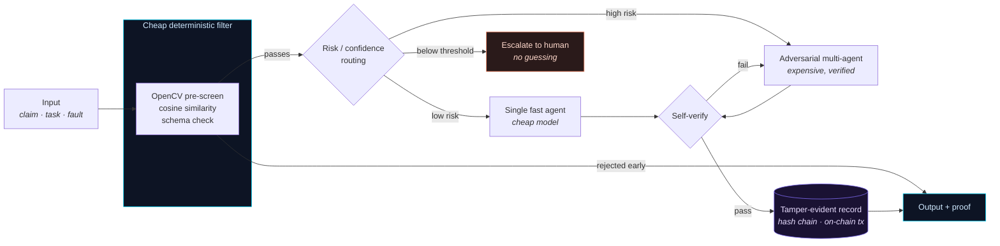
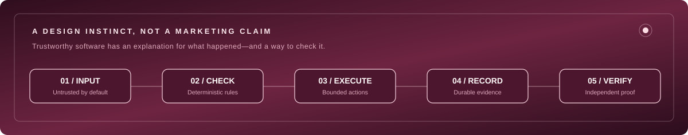
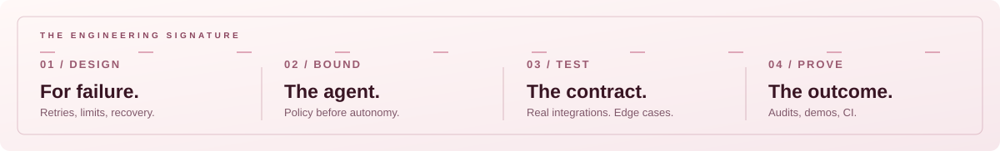

  

 

## The thesis

Autonomous systems are being handed real authority — approving claims, patching production, routing work — and almost none of them can **prove** what they did. The reasoning is a black box, the logs are mutable, and "trust me" is the entire audit story.

Every serious thing I've built in the last twelve months attacks that from a different angle: writing agent decisions to an immutable ledger, hash-chaining a self-healing system's state transitions, forcing adversarial verification before a verdict, sandboxing an AI that rewrites your code. Different domains, one obsession — **make the machine produce receipts.**

I'm a BSc CS student. I learn by building the hard version.

 

## Receipts

> Commit counts below are **mine specifically**, not repo totals. Team projects are marked.

<table>
<tr>
<td width="50%" valign="top">

### ⛓️ [TrustChain](https://github.com/nipunkalsotra/TrustChain)
**Every AI agent decision, permanently on-chain.**

A 4-agent LangGraph pipeline where each decision, tool call, and handoff is written as a transaction on the Monad blockchain. Click any step in the live feed → jump to its transaction on the explorer.

`3 Solidity contracts deployed` · `SSE live streaming` · `MCP tool servers` · `k6 load tests` · `gitleaks + pre-commit + semantic-release`

**Python · TypeScript · Solidity · Next.js 14 · FastAPI · LangGraph · web3.py · Groq**
 👥 Team of 2 · 28 commits mine

</td>
<td width="50%" valign="top">

### 🛡️ [NeuralGuard](https://github.com/nipunkalsotra/NeuralGaurd)
**A workflow orchestrator that heals itself.**

Detects a stuck agent in under a second, diagnoses root cause, generates *and verifies* a patch, reroutes around the failure — zero humans. Every state transition lands in an append-only **SHA-256 hash-chained** audit log: mutate one record and every hash after it fails.

The frontend ships a from-scratch **TypeScript port of the entire orchestration core**, so the deployed site runs a real healing cycle with no backend at all.

`7-state FSM` · `4 async agents` · `circuit breakers` · `cosine-similarity loop detection @ 0.92`

**Python 3.14 · FastAPI · React 19 · Vite · WebSockets · Docker**
 👥 Team of 2 · 48 commits mine · top contributor

</td>
</tr>
<tr>
<td width="50%" valign="top">

### 🔍 [TruthFrame](https://github.com/nipunkalsotra/TruthFrame)
**Six-stage claim verifier, built in 24 hours.**

Decides whether a photo *supports*, *contradicts*, or *can't settle* a damage claim. OpenCV pre-screening kills wasted API calls, a token-bucket limiter saturates the quota, and risk-adaptive routing scales compute to claim complexity — with an adversarial multi-agent pass reserved for the expensive edge cases.

`HackerRank Orchestrate 2026` · `self-correcting schema loop → 100% compliance`

**Python · Gemini Vision · Groq LLaMA 3 · OpenCV · asyncio**
 👥 Hackathon team · 13 commits mine

</td>
<td width="50%" valign="top">

### 🍽️ [Mini Restaurant OS](https://github.com/nipunkalsotra/mini-Restaurant-OS)
**Full-stack, shipped, and actually live.**

Menu → cart → customer → order lifecycle → billing → payment → sales tracking. The whole loop, deployed across three providers and running in production.

[**→ mini-restaurant-os.vercel.app**](https://mini-restaurant-os.vercel.app)

**React · FastAPI · PostgreSQL · SQLAlchemy · Vercel · Render · Neon**
 🧍 Solo · 57 commits — my largest solo build

</td>
</tr>
</table>

<b>Four more worth opening →</b>

 

| Project | The interesting part | Stack |
|---|---|---|
| 🐚 [**Custom POSIX Shell**](https://github.com/nipunkalsotra/CodeCrafters-OS-Shell) | A Unix shell from scratch — quote-aware parsing, redirection, pipelines, background jobs, builtins. No shell library, just syscalls and a parser. | Java 26 · Maven |
| 🧠 [**IdeaGuard**](https://github.com/nipunkalsotra/Local-AI-Debugging-Sandbox) | Autonomous debugger that runs **fully offline**. Catches a crash, spins an ephemeral Docker container capped at 512 MB with **no internet**, and loops `run → crash → patch → verify` using a local 1.5B model.  🏆 *Winner — "Engineering Depth" challenge* | Python · Ollama · Docker · Rich TUI |
| 🔀 [**Dynamic ETL Pipeline**](https://github.com/nipunkalsotra/Dynamic-ETL-Pipeline) | Schema-drift-tolerant ETL — the schema manager adapts to changing source shapes instead of crashing on them. | Python |
| ✍️ [**BlogForge AI**](https://github.com/nipunkalsotra/BlogForge-AI) | LLM content generation pipeline, notebook-first. | Jupyter · Python |

**Also in flight:** [OmniTrace](https://github.com/Shreshtha280407/OmniTrace) — a multimodal evidence fabric for RAG. Video, audio, image and PDF ingested into MongoDB Atlas, linked across modalities with typed timestamped relationships, retrieved as **evidence bundles instead of isolated chunks**. Phases P0–P8 complete: ASR, OCR, entity enrichment, RRF retrieval, grounded generation with validators.

 

## The pattern underneath

Look at four of these side by side and the same skeleton keeps showing up. I didn't plan that — I noticed it afterward, and now I build to it deliberately.

Four rules I keep landing on:

1. **Spend the cheap check first.** OpenCV before a vision model. Cosine similarity before an LLM diagnosis. Most work shouldn't reach the expensive path.
2. **Route by risk, not uniformly.** A trivial case and a high-stakes case should not cost the same.
3. **Below the confidence threshold, escalate — don't retry.** A retry loop on a confused model is just an expensive way to stay wrong.
4. **Nothing is finished until it's recorded somewhere that can't be quietly edited.**

 

## Twelve months

  

First commit: <b>August 2025</b> — a dictionary lookup page, 724 bytes of HTML. 
Twelve months later: hash-chained orchestrators and agent decisions committed to a blockchain.

 

## Stack

I've grouped these by what I actually reach for, not by what I've once installed.

<table>
<tr><td><b>Systems I reach for first</b></td><td>

`Python` `TypeScript` `FastAPI` `React` `Next.js` `PostgreSQL` `Docker`

</td></tr>
<tr><td><b>Agents & LLM orchestration</b></td><td>

`LangGraph` `Groq` `Gemini Vision` `Ollama` `MCP servers` `asyncio` `token-bucket rate limiting`

</td></tr>
<tr><td><b>Verifiability layer</b></td><td>

`Solidity` `web3.py` `Monad` `SHA-256 hash chains` `append-only audit logs`

</td></tr>
<tr><td><b>Lower level / for the understanding</b></td><td>

`Java` `C` `Linux syscalls` `shell scripting` `POSIX process management`

</td></tr>
<tr><td><b>Around the code</b></td><td>

`k6` `pre-commit` `gitleaks` `semantic-release` `SQLAlchemy` `Vite` `WebSockets` `SSE`

</td></tr>
</table>

 

## By the numbers

  

Commit count is <b>mine specifically</b> — 183 of the 266 across these repos. Language mix measured by bytes.

 

## What I'm after

I want to work on systems where correctness is checkable rather than asserted — agent infrastructure, developer tooling, distributed backends, anything where "how do you know it worked?" has a real answer.

I'm most useful on problems that are slightly too hard for me at the start. That's been the pattern for twelve months and it hasn't stopped working.

 

**[📬 kalsotranipun@gmail.com](mailto:kalsotranipun@gmail.com)** · **[💻 github.com/nipunkalsotra](https://github.com/nipunkalsotra)**

 
<i>If you can't verify it, you can't trust it.</i>

